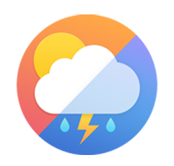
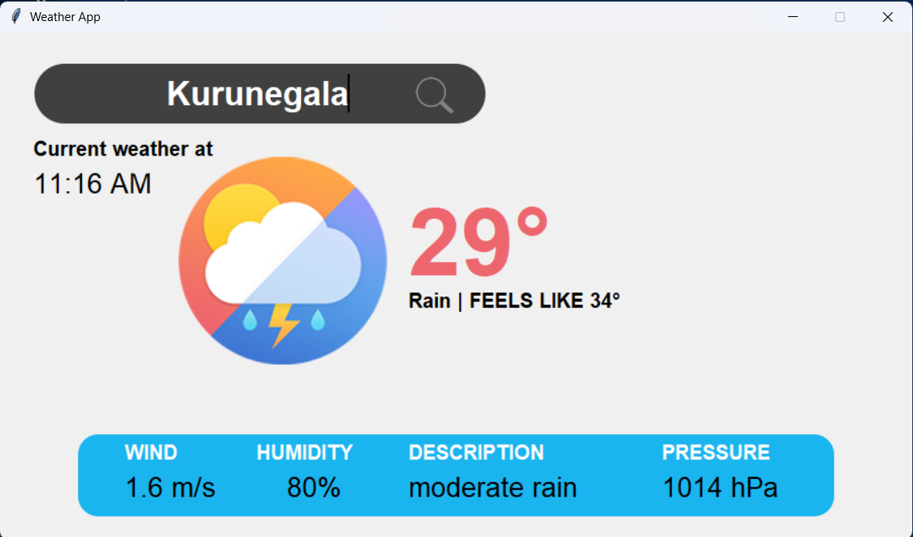
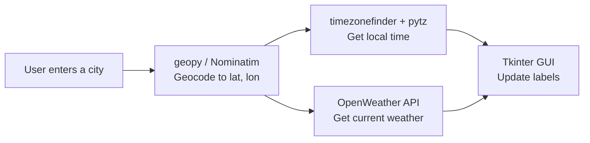

<div align="center">



# 🌦️ Weather App

**A desktop weather application built with Python & Tkinter that shows real-time weather and local time for any city in the world.**


</div>

---

## 📖 Overview

Weather App is a lightweight GUI application. You type the name of a city, town or landmark, and it shows:

- 🌡️ **Current temperature** and **"feels like"** temperature (°C)
- ☁️ **Weather condition** and a short **description** (e.g. *Clouds – broken clouds*)
- 💨 **Wind speed**, 💧 **humidity** and 🔽 **atmospheric pressure**
- 🕒 **Local time** at the searched location, adjusted for its time zone

The app chains three services together. It **geocodes** the place name into coordinates, **finds the time zone** for those coordinates, then **fetches live weather data** from the OpenWeather API.

<p align="center">
  
</p>

---

## 📸 App Screenshots

<table>
  <tr>
    <td align="center" width="33%">
      
      <br><b>Country search: Sri Lanka</b>
    </td>
    <td align="center" width="33%">
      
      <br><b>City search: Colombo</b>
    </td>
    <td align="center" width="33%">
      
      <br><b>Town search: Kurunegala</b>
    </td>
  </tr>
</table>

Each search updates the **local time**, **temperature**, **feels-like temperature**, **condition**, **wind**, **humidity**, **description** and **pressure**.

---

## ✨ Features

| Feature | Description |
|---|---|
| 🔍 **Search any place** | Accepts cities, towns, countries or landmarks, resolved through OpenStreetMap Nominatim |
| 🌍 **Time-zone aware clock** | Shows the real local time of the searched location, not your own system time |
| 📡 **Live weather data** | Fetched in real time from the OpenWeather Current Weather API |
| 🛡️ **Error handling** | Shows clear pop-ups for empty input, unknown locations, network failures, timeouts and invalid API keys, instead of crashing |
| 🔐 **Secure configuration** | The API key is loaded from a `.env` file and is never hard-coded or committed |
| 📁 **Portable asset loading** | Images load relative to the script, so the app runs from any working directory |

---

## 🛠️ Tech Stack & Skills Demonstrated

| Area | Technologies / Concepts |
|---|---|
| **Language** | Python 3 |
| **GUI development** | Tkinter: windows, `Entry`, `Button`, `Label`, `PhotoImage`, absolute layout with `place()` / `pack()`, event callbacks |
| **REST API integration** | `requests`: query parameters, timeouts, HTTP status checks, JSON parsing |
| **Geocoding** | `geopy` (Nominatim / OpenStreetMap) to convert place names to latitude and longitude |
| **Time zones** | `timezonefinder` + `pytz` to convert coordinates into a time zone and the local time |
| **Configuration & security** | `python-dotenv` and environment variables to keep secrets out of source control |
| **Robustness** | Defensive programming: input validation and handling for network, service and API errors |
| **Tooling** | Git version control, virtual environments, `requirements.txt` dependency management |

---

## ⚙️ How It Works



1. **Input:** the user types a location and clicks the search button.
2. **Geocoding:** `Nominatim.geocode()` converts the text into coordinates.
3. **Time zone:** `TimezoneFinder.timezone_at()` returns the IANA time zone (e.g. `Asia/Colombo`), and `pytz` turns it into the current local time.
4. **Weather:** a `GET` request goes to `api.openweathermap.org/data/2.5/weather` with the coordinates and `units=metric`.
5. **Display:** the JSON response is parsed and every label in the GUI is updated.

---

## 🚀 Getting Started

### Prerequisites

- **Python 3.10+** with Tkinter (included with the standard Python installer on Windows and macOS; on Linux, install `python3-tk`)
- A free **OpenWeather API key**. Sign up at [openweathermap.org/api](https://openweathermap.org/api). New keys can take a little while to activate.

### Installation

```bash
# 1. Clone the repository
git clone https://github.com/<your-username>/<your-repo-name>.git
cd <your-repo-name>

# 2. Create and activate a virtual environment
python -m venv .venv
# Windows
.venv\Scripts\activate
# macOS / Linux
source .venv/bin/activate

# 3. Install dependencies
pip install -r requirements.txt
```

### Configuration

Copy the example environment file and add your API key:

```bash
# Windows
copy .env.example .env
# macOS / Linux
cp .env.example .env
```

Then edit `.env`:

```env
API_key=your_openweather_api_key_here
```

> ⚠️ `.env` is listed in `.gitignore`. Never commit your real API key.

### Run the App

```bash
python weather.py
```

---

## 🧭 Usage

1. Launch the app with `python weather.py`.
2. Type a location into the search bar, for example `London`, `Tokyo` or `Colombo`.
3. Click the 🔍 **search** icon.
4. The app shows the local time, temperature, condition, wind, humidity, description and pressure for that place.

| Situation | What the app does |
|---|---|
| Empty search box | Asks you to enter a location |
| Location not found | Shows "Location '…' not found" |
| No internet / service timeout | Shows a connection error message |
| Missing or invalid API key | Shows the error returned by the OpenWeather API |

---

## 📂 Project Structure

```
Weather App/
├── images/              # GUI assets and README screenshots
│   ├── box.png
│   ├── logo.png
│   ├── search.png
│   ├── search_icon.png
│   └── Screenshot_1-3.png
├── .env.example         # Template for environment variables
├── .gitignore           # Keeps secrets and local files out of Git
├── requirements.txt     # Python dependencies
├── weather.py           # Application entry point (GUI + logic)
└── README.md
```

---

## 🔮 Future Improvements

- [ ] 5-day / hourly forecast using the OpenWeather forecast endpoint
- [ ] Weather-condition icons that change with the current weather
- [ ] °C / °F unit toggle
- [ ] Press **Enter** to search
- [ ] Remember recent searches
- [ ] Package as a standalone executable with PyInstaller

---

## 🙏 Acknowledgements

- [OpenWeather](https://openweathermap.org/) for the weather data API
- [OpenStreetMap Nominatim](https://nominatim.openstreetmap.org/) for geocoding
- [geopy](https://github.com/geopy/geopy), [timezonefinder](https://github.com/jannikmi/timezonefinder) and [pytz](https://pythonhosted.org/pytz/)

---
